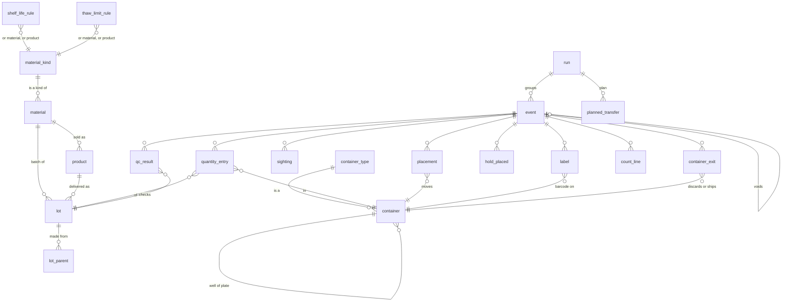

# Data model

This is the design in one place. The SQL lives in [`schema/`](../schema/), in the order it runs. The rules behind it are in [`principles.md`](principles.md), and the choices we made along the way are in [`decisions.md`](decisions.md).

## The short version

The inventory stores two kinds of thing: **facts** (something happened in the lab, at a time, and someone recorded it) and **rules** (how long loading buffer lasts, how many times a target can be thawed). Everything the lab reads, including how much is left, how much of that is usable and why not, where a plate is, when something expires and what a bad batch touched, is worked out from those two when someone asks.

Facts are never changed or deleted. A mistake is fixed by a new fact that voids the wrong one and, if needed, says what really happened. Every fact carries two times: when it happened at the bench, and when it was written down. Together these let us answer both "what's true?" and "what did we believe at the time?".

## The four things we keep apart

Most inventory problems in the brief come from blurring these.

| | What it is | Example |
|---|---|---|
| **Material** | What something is | EGFR extracellular domain; loading buffer; the protein of design D-0042 |
| **Lot** | One batch of it, with a history | Delivery DN-9001 of supplier lot L4471; the loading buffer Lena made on Monday |
| **Container** | A physical thing that holds material or other containers | Tube TGT-0001; well B7 of an expression plate; box 7; freezer F1 |
| **Contents** | How much of which lot is in which container right now | 24 µL of lot 12 in tube ALQ-007 |

Contents aren't stored. They're the running total of the ledger (below), per container and lot. That's what lets a well hold two lots at once, and lets an expression plate keep its barcode while what's inside changes from DNA to protein.

## Diagram

## How each thing the brief asked about works

### Differences between material types

A material kind is a row, not a table. It says what dimension the material is usually counted in (volume, mass, count or activity), whether new lots need QC before use, and which attributes every material of that kind must have. DNA must have a `design_id`, and a target must name its `protein`. Anything else specific goes in a JSON `attributes` column, checked against the kind.

Behaviour that differs between types lives in rules that can point at a kind, a material or a single supplier product, with the most specific one winning. Adding small molecules means adding one kind row, a few materials and their shelf-life rules. Test `20_new_material_kind.sql` does exactly that with no schema change.

### Storage locations and things that move between them

Freezers, fridges, benches, instruments, racks, boxes, plates and tubes are all containers. Places that set a storage condition (−80 °C, −20 °C, fridge, room) carry it. A move is a fact that puts a container into another one, optionally at a position like a box slot. Wells are the exception: they're fixed in their plate for good.

From the moves we work out, at any moment:
- **Where something is.** The chain upwards, like `Freezer F1 > Rack 3 > Box 7 @C4`. Moving a box moves everything in it, because the tubes are still in the box.
- **What condition it's in.** Taken from the nearest place above it that has one. A tube in a box in a −80 freezer is at −80.
- **How sure we are.** When it was last confirmed and how (a scan, a robot, a count). A move typed in by hand doesn't count as a confirmation. A tube missing from a count becomes "location uncertain" until it's seen again.

Barcodes are labels a container wears for a while, not the container's identity. A barcode can be on only one live container at a time, and the database refuses a second one. If a clash slips in anyway, say through an import, both containers are blocked until a person sorts it out.

### Quantities and expiration

Quantities are a ledger. Every receipt, transfer, use, loss or adjustment adds a line with a signed amount, in the base unit of its dimension: µL, µg, pieces or activity units. The amount in a container is the sum. Nobody types "200 µL left".

Expiry is never stored either. Each lot in each container can have several clocks running at once:
- the supplier's expiry date
- time since it was received or made (loading buffer: 7 days)
- time spent in its current storage condition (thawed target: 7 days in the fridge)

The earliest one wins, and the answer says which clock and which rule decided it. The time-in-condition clocks are worked out from the move history, so moving GFP stock from the freezer to the fridge starts its fridge clock automatically. Rules have versions with a start date. A shorter rule applies to existing stock from the day it starts, but questions about the past still use the old rule (decision D5).

Freeze-thaw cycles are counted the same way: each time a container goes from a freezer to anywhere warmer. An aliquot inherits the thaws its parent tube went through before the split.

### Consumption, including material moving into other containers

Every lab task is a run (a split, a robot plate transfer, a BLI run) made of events. Each event has ledger lines:
- **Transfer.** Minus here, plus there, same lot. Splitting a tube into 20 is one event with 21 lines, and the lines can't create liquid out of nothing without it showing.
- **Make.** Minus each input, plus one new lot, with "made from" links to every input lot. Buffers from components, a diluted working stock, and protein from DNA in each well of an expression plate all work this way.
- **Consume.** Minus, used up in a run (a BLI run uses its target and sample wells).
- **Loss.** Minus, gone without being used (evaporation, a spill), with a reason.

Robot runs keep the plan (`planned_transfer`) next to what the robot's log says it did. Only logged steps move liquid, and a finished run with missing steps raises a flag. A robot log line identifies itself by run and step, so a retried upload can't be counted twice.

### Usable versus merely existing

`usable(t, k)` returns, for every lot in every container, how much we hold, how much of it can be used, and if not, every reason why:
- thrown away or shipped (we still know it existed, and what was in it)
- waiting for QC, or failed QC
- the lot or the container is on hold
- expired, by whichever clock ran out first
- barcode clash
- location uncertain after a count
- negative balance (more was taken than the records said was there)
- below dead volume (the last few µL a pipette can't reach)

Warnings don't block use but point at things worth checking: over the freeze-thaw limit, expiring within 14 days. When something can be used, the usable amount is what's held minus the container's dead volume.

## Asking about the past

Every calculated function takes two times. `t` is the moment in the lab we're asking about. `k` is how much of the record to believe, by when it was written down.

| Question | t | k |
|---|---|---|
| How much is in this tube now? | now | now |
| What did the system say last Tuesday? | Tuesday | Tuesday |
| What do we now know was really there last Tuesday? | Tuesday | now |
| Will this still be usable for the re-run on Friday? | Friday | now |

## The few things the database refuses outright

Everything else is recorded and flagged (principle 4), but these are refused:
- Changing or deleting a fact or a rule.
- A correction without a reason, or recorded before the thing it corrects.
- The same real-world action twice: the same delivery note, or the same robot run and step.
- A barcode that's already on another live container, unless it comes from an import.
- Putting a container inside itself, however deep.
- A lot "made from" a younger lot, so lineage can never loop.
- A material missing an attribute its kind requires.

## Known limits

- **Speed.** The calculated functions work everything out from scratch on every call. That's the right starting point for correctness and easy to read, but it won't be fast at Adaptyv's scale. The fix is to cache the results as materialized views or summary tables kept up to date by triggers, and check them against the from-scratch versions in tests. The design doesn't change.
- **Converting between dimensions.** Reconstituting dry DNA turns µg into µL within the same lot, and the concentration is recorded as a measurement. We don't automatically convert one into the other when someone asks "how many µg are left?". The answer is given in whatever dimension it was last recorded in.
- **Concurrency.** Two people drawing on the last 50 µL at the same moment are both recorded and flagged by the negative balance. We don't add row locking, because recording what happened matters more than stopping it.
